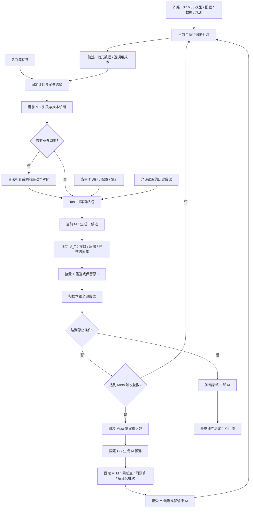

# VideoSpy 双层 RSI：完整循环与数据流实现规格

日期：2026-10-08。状态：待用户审阅的实现规格；本文件不表示已经完成代码或实验。

本规格沿用通用 VideoSpy 的 Task/Meta 双层程序进化，暂不增加医学专用机制。可进化对象的背景见 [双层设计](videospy_dual_layer_rsi_design.md)。本文件明确运行顺序、数据权限、模块输入输出、版本提交和第一阶段范围。

## 1. 角色与状态

| 名称 | 职责 | 是否进化 |
|---|---|---|
| Task 程序 T | 根据问题和合法视频/帧、字幕，调用三个工具并回答 | 是 |
| Meta 进化器 M | 选择案例、诊断、调查、生成 Task 补丁 | 是；首版只开放诊断器、Task proposer |
| 外层更新器 G | 根据多轮进化记录生成 Meta 补丁 | 首版固定 |
| Task 验证器 V_T | 运行候选，计算任务质量和成本，决定是否接受 | 固定 |
| Meta 验证器 V_M | 在匹配条件下运行新旧进化器，比较产出的 Task 程序 | 固定 |
| Runner / Recorder / Archive | 执行、数据权限、成本计量、版本及档案 | 固定 |

正式运行状态：`RunState = (current_task_id, current_meta_id, task_round, meta_round, attempts_since_meta, budget_state)`。

- 初始 `T0` 是当前基础 VideoSpy；插件化改造应先验证行为一致。
- 初始 `M0` 是人工规定的进化流程，并非当前已有完整实现。
- Task 每完成一个诊断批次，启动一次候选生成/筛选轮次，不在单题中改代码。
- 一个正式 Task 轮次结束即增加 `attempts_since_meta`，接受、拒绝、无候选都计数；重试和同轮多个候选不重复计轮。
- 示例默认每 3 个正式 Task 轮次触发一次 Meta 更新；这是建议配置，尚未经实验选择。
- 每个 Task 轮次冻结当前 M；Meta 更新完成后，新 M 只影响后续 Task 轮次。

部署只使用最终 T 及其经验资产；M、G 不在普通视频 QA 中调用。

## 2. 可进化与固定边界

| 层 | 首版可改 | 首版固定 |
|---|---|---|
| Task | 三个工具的内部采样/图像组织/观察提示；执行策略；工作上下文；白名单参数；可选 Task/Domain Skill | 三个工具名称及必需参数、合法 reader、模型权重与角色配置、证据基本要求、最终答案协议、计量/记录/验证 |
| Meta | `diagnoser` 的提示和程序；`task_proposer` 的提示、输入组装和程序 | 初始案例选择、调查执行与预算调度、公共接口、最终验证、接受规则 |
| G | 无 | Meta 输入组装、候选提案流程、模型配置与权限 |

Task 主 Agent 包装器继续承担工具权限、重复请求检查、最终回答、硬上限和日志；不直接开放整个 `agent.py`。抽出可改策略模块。工具修改必须通过固定 reader/model 调用入口。

Skill/Memory 状态都要进入 Task manifest。首版允许 Skill 作为显式候选资产；默认事实 Memory 关闭。后续启用 Memory 时父版本与候选使用同一冻结快照，独立研究事实记忆更新。

默认公共工具仍是 `overview(query)`、`clip_skim(query,start_time,end_time)`、`frame_inspect(query,timestamps)`。候选不能增加数据访问范围，不能读标签作运行时分支。

## 3. 总体流程



实际调度每次进入新阶段前检查剩余预算；Meta 更新后也检查停止条件，再决定开始下一批或冻结版本。

## 4. 数据划分及读取权限

### 4.1 四类数据用途

| 数据 | 用途 | 允许进入生成模型的反馈 |
|---|---|---|
| `D_diag` | 正式内层执行、诊断、局部调试、主动调查 | 逐题问题、训练标签、轨迹、成本、调查结果 |
| `D_gate` | Task 候选完整选择与父版本比较 | 固定的整体/任务类别质量与成本统计、状态和错误类型；无逐题标签/轨迹 |
| `E_meta` | 新旧 M 的独立内层搜索评测，包含多个 episode | G 只获得预先定义的外层汇总；episode 数据不提供给 G |
| `D_test` | 全部进化结束、版本冻结后的最终测试 | 不进入 M、G 或搜索档案可读视图 |

`D_diag` 内按固定批次计划执行，批次可以按任务类别组织，但当前 T 和 M 在批次执行期间保持不变。改变 M0 案例选择策略属于后续实验，不混入首版。

按来源视频隔离四种用途；多问题同一来源不能跨用途。EgoLife 延续主体、来源和时间约束；MedVidBench 只访问提供的帧。若来源关系无法确定，记录限制，不声明已经完成严格独立划分。

### 4.2 Meta episode 的三份内部数据

每个 `episode` 指定 `start_task_id`、任务类别、种子、模型/环境、搜索预算和三份按来源隔离的数据：

1. `probe`：内层诊断批次，新旧 M 均可访问该份的训练标签及轨迹。
2. `inner_gate`：episode 中筛选 Task 候选；M 仅获得聚合反馈。
3. `report`：分支内层搜索结束后，评价最终 Task；搜索期间完全不可见。

`report` 的标签只由固定 V_M 使用。它与 `inner_gate` 分开，避免把“反复挑选后的验证分数”直接当 Meta 泛化收益。

E_meta 上的 Task 轨迹和进化过程仍保存，但使用外层验证私有作用域；不能放入 M/G 的普通历史检索入口。G 可读外层总体及预先定义的类别汇总，不能读该批次逐题数据。重复使用聚合结果仍有适应性过拟合，故外层搜索轮数需预先限制。

### 4.3 标签与视频数据分开流动

- `TaskRunner` 接收问题、选项、合法 reader、字幕和部署时可用元数据；不接收真值。
- `Assessor` 在运行后连接真值与预测，输出评估结果。
- M 的诊断/提案可使用 `D_diag` 真值，但不能将其复制到候选推理提示、视觉调查查询或运行时配置。
- `Investigator` 接收不含答案的检查目标和合法范围；不能向视觉模型提示“标准答案是某动作”。
- 验证器运行候选时仍移除真值，只在运行结束后计分。

访问控制不能只靠 Prompt。固定数据服务按角色/作用域返回输入；候选运行环境不提供标签文件、全量私有档案或验证器内部对象。

## 5. 需要交换与保存的数据对象

所有数据使用稳定 ID；真实视频/图片不在组件间反复复制，主要传 reader 描述、来源及帧引用。原始记录完整保存，输入包只携带预算内材料和可读取记录的索引。

| 对象 | 最少字段 | 生产方 → 消费方 |
|---|---|---|
| `TaskManifest` | ID、parent、源码/配置/资产哈希、模型指纹、工具接口、reader 契约、Skill/Memory 引用 | Archive → Runner、M、V_T、V_M |
| `MetaManifest` | ID、parent、诊断/提案源码和提示哈希、固定模块引用、配置、接口 | Archive → TaskLoop、G、V_M |
| `BatchManifest` | 数据作用域、样本 ID、来源组、批次序号、seed、允许时间/帧范围 | 数据适配器 → Runner、验证器 |
| `ExecutionRecord` | 样本、T/M/round ID、问题引用、预测、完整轨迹引用、停止原因、错误、调用索引、成本状态 | Runner → Assessor、案例选择、Archive |
| `VisualObservation` | 工具/调用 ID、请求参数、实际帧索引/时间、原始与输入尺寸、拼图/裁剪变换、字幕范围、来源 | 固定工具包装器 → 诊断、调查、引用校验 |
| `CallRecord` | 阶段、角色、T/M/candidate/branch ID、输入/输出引用、usage、elapsed、attempt、错误 | 固定 ModelClient 记录器 → 成本汇总、Archive |
| `Assessment` | 样本、正确性及来源、证据充分性、0–5 反思分数、理由、unknown 字段 | 固定 Assessor → 案例选择、诊断 |
| `DiagnosisReport` | 案例组、现象、多种原因、支持/反例、责任模块、未确定项、调查请求、成本集中项 | M.diagnoser → 调查、M.proposer、G 历史 |
| `InvestigationRecord` | 前缀/状态哈希、目标、动作、实际新观察、可选续跑、前后结果、成本、有效性 | Investigator → proposer、Archive |
| `TaskProposalInput` | 当前 T、当前 M、案例/诊断/调查、代码、历史视图、资源及契约 | 固定输入服务 → M.proposer |
| `Candidate` | layer、parent、generator、实际补丁/资产、假设、依据、风险、预测、检查计划 | M 或 G → 固定验证器 |
| `ValidationReport` | candidate、父版本、数据/环境、检查与完整运行引用、Q/C、usage 状态、违规/异常、决定 | V_T/V_M → 提交器、脱敏反馈视图 |
| `EvolutionAttempt` | M、T 起点、实际 proposer 输入、诊断/调查/补丁、修复、全部验证、预期—实际差异、费用、结果 | TaskLoop → G、历史检索 |
| `MetaProposalInput` | 当前 M、Task 起点、多轮 attempt、成功/失败对照、搜索收益/成本、Meta 历史、固定契约 | 固定输入服务 → G |
| `EpisodeResult` | M、起始/最终 T、搜索预算/实际花费、内层轨迹私有引用、report Q/C、异常 | V_M 分支 → V_M 汇总、G 受控视图 |

`TaskProposalInput` 与 `MetaProposalInput` 同样保存“模型实际看到的内容”，包括选中的材料、未加载索引和组装策略。只有结果日志而没有输入，无法判断 Meta 的诊断/提案为何失效。

## 6. 内层 Task 循环：逐步输入输出

### T1：准备与执行

固定 Runner 读取 `current_task_id/current_meta_id`，解析不可变 manifest，使用当前 T 运行下一诊断批次。

输入：Task 快照、问题、合法视频/帧 reader、字幕、部署元数据。输出：ExecutionRecord、完整 Trajectory、VisualObservation、CallRecord。一批结束前不修改当前 T。

### T2：评估并选择案例

固定 Assessor 将 D_diag 标签连接到执行结果。复用当前 0–5 反思评估和分数均衡分组，再选错误/证据不足、正确但昂贵、正确且高效对照。

输出：Assessment、CaseGroup 和原始记录索引。反思分数辅助诊断，不代替 benchmark 固定指标。评分失败保留 unknown，不伪造成功。

### T3：当前 M 诊断

输入：CaseGroup、当前 T 的相关源码/配置、轨迹、帧元数据、阶段成本、相关历史。输出 DiagnosisReport，允许多原因或无法判断。

首版可用五类原因：采样覆盖、细节可见性、工具观察表达、主 Agent 证据使用、搜索/停止策略。标签只是诊断词表，不要求硬分类。

### T4：可选调查

固定 Investigator 接收 DiagnosisReport 中的有界检查请求。首版支持定向补看；同前缀多动作比较作为显式开关。

同前缀比较恢复原问题、消息、观察、已用预算、overview 状态与重复请求集合等真实状态，不只复制一段文字。记录继承状态，临时调查不能使正式 QA 的工具权限失效。

调查最多执行配置允许的次数；无调查、调查失败或无新证据均允许进入提案阶段。调查费进入离线成本，调查结果不是 T' 的运行成绩。

### T5：生成 Task 候选

固定服务组装 TaskProposalInput；当前 M.proposer 输出 0–2 个实际补丁候选。

- 每个候选基于同一 T 父版本，优先一个主要机制和必要依赖。
- Skill 更新显式列入候选资产，与代码一起验证；不能在候选验证之后无记录地追加 Skill。
- 自然语言建议、不存在的补丁、父版本不匹配或空变更，不算有效代码候选。
- 可允许 1 次局部修复；修复形成新 candidate/revision ID，费用全部记录。
- 分别通过的补丁若要组合，组合后是新候选，重新完整验证。

### T6：固定分阶段验证

顺序：补丁范围/接口与可装载检查 → 诊断相关案例及成功反例 → D_gate 完整 QA。

候选在独立目录和新进程执行，避免 Python 模块缓存混淆版本。目录隔离只解决版本问题；候选所能读取的数据与调用服务另由固定运行器控制。

D_gate 父版本与候选使用同一 manifest、模型、reader、种子及固定评分方法。父版本的相同条件确定结果可复用，条件改变则重跑。候选失败、未完成、格式错误保留并计入总体结果，不删除困难问题。

### T7：选择、提交与反馈

候选满足固定准则才有资格接受；多个合格候选按固定排序确定一个当前版本。示例排序：先质量、再完整 QA 成本、再候选 ID；不由 proposer 自选胜者。

候选无合格结果则保持当前 T。接受时提交包含源码、配置、经验资产的完整 manifest，随后原子更新 `current_task_id`。

M 可读：诊断案例完整结果、修复错误、D_gate 总体及预定义类别反馈。M 不可读 D_gate 的逐题标签和轨迹。

### T8：归档并调度

写入 EvolutionAttempt，包含被拒绝、异常、无候选、无改善以及全部成本。正式轮次计数 +1。若尚未停止且累计达到 H，则进入外层；否则开始下一诊断批次。

## 7. 外层 Meta 循环：逐步输入输出

### M1：整理进化经验

固定服务读取当前 M、多轮正式 EvolutionAttempt、Task 起点、历史候选补丁、预测/实际差异、失败/成功对照及总体搜索成本，生成 MetaProposalInput。

首版输入可包含当前 M 生命周期内全部尝试摘要与相关旧历史；不是只把最后一个失败 Task 轨迹当作 Meta 经验。

### M2：G 生成 Meta 候选

固定 G 比较输入中的重复问题，生成 0–1 个 M' 补丁。首版只允许修改 diagnoser/proposer 的程序、提示和输入组装。

例如：修改 diagnoser 先检查实际采样覆盖；修改 proposer 强制携带一个成功反例。M' 可改变处理方式，但不能更改接口、权限、硬预算、评价器、Task 接受门槛或跳过固定验证。

### M3：接口与局部运行检查

固定验证器验证补丁范围、接口、装载、结构化输出和小型试运行。只在接口检查通过后进入昂贵的内层搜索比较。

### M4：构造配对 episode 分支

对于固定 episode 列表中的每个起点 T_start：

```text
同一 T_start + 同一 probe/inner_gate/report + 同一 seed + 同一搜索预算
    ├─ 分支 old：用当前 M_s 运行若干 Task 进化轮次 → T_old_final
    └─ 分支 new：用候选 M' 运行若干 Task 进化轮次 → T_new_final
```

两分支的每一步依然是完整 T1–T8，但禁止在分支中再触发外层 Meta 更新。

- 每个分支有自己的 Task 指针、档案、模型上下文、缓存和预算。
- 初始历史视图相同；随后只读取本分支历史，不能利用另一分支新生成的经验。
- 每个 episode 从指定原始起点重新开始，不沿用其他 episode 的最终 Task。
- 内层轮数只是上限；比较的主要约束为相同搜索预算，候选数量和实际轮数可不同。
- 首版外层比较关闭跨分支推理结果缓存，以免计量与可用预算不对称。同一分支内复用规则由固定运行器统一管理。
- 主循环暂停正式版本更新，避免评价中的起点和 M 发生变化。

### M5：评价分支产物

分支搜索结束后，V_M 在该 episode 的 report 上运行起点 T_start、T_old_final、T_new_final，计算任务质量和完整 QA 成本。起点结果用于计算改进；新旧分支直接比较用于判定 M'。

report 运行费用属于外层验证成本，不计入分支可自由支配的搜索预算；新旧方法执行相同评价协议。总实验成本仍包含它。

输出 EpisodeResult，所有原始结果私有保存。G 仅获得总体和预定义类别的汇总、成本与失败状态。

### M6：选择与提交

V_M 用预先固定的规则判断 M' 是否在同预算下产生更好的 Task 程序，或以更少搜索成本达到指定质量—成本目标。接受率、补丁数量、解释质量仅为诊断指标。

首版使用“固定预算下产出比较”模式；提前到达目标的时间/成本作为补充统计。跨 episode 聚合方法及退化界限在实验前确定，不能看到某个候选后临时改变权重。

接受则提交不可变 Meta manifest，更新正式 `current_meta_id`；拒绝或无候选保留旧 M。无论结果如何，本次 Meta 触发窗口结束并将 `attempts_since_meta` 清零，避免每个后续轮次立即重试同一次外层更新。

**正式 current_task_id 保持不变。** 外层分支的 Task 产物属于验证档案，不自动替代正式 T，也不直接导入正式 Task 的 Skill。

### M7：回到正式内层

下一正式 Task 批次使用原正式 T 和接受后的 M。M' 若被接受，其产生 Task 候选的收益在此后逐步体现；不是把某个外层验证分支已经优化好的 Task 当作正式更新。

## 8. 版本状态机与验收原则

候选状态：`proposed → checking → local_validated → gate_validated → accepted/rejected`。异常、预算不足或评价不完整可以进入 `failed/incomplete`；均保留档案。

- `accepted` 是固定提交器的结果，模型不能自行宣告。
- 补丁应用于精确父哈希；父版本不匹配时失败，不自动修改正式父版本。
- 文件写完、哈希校验、所有必检和计量通过后才更新正式指针。
- 接受版本不可再原地编辑；修复形成新的候选或版本。

Task 评价使用 benchmark 适配器预先定义的质量 Q 和完整 QA 平均 token 成本 C。异构任务使用固定指标向量或预先规定的聚合，不能临时将不同量纲均分。

初始质量退化容忍建议为 0。可接受方向：

1. 质量改善达到固定最小幅度，成本增长不超过预设比例。
2. 成本下降达到固定最小幅度，质量不低于声明下界。

最小改善、成本比例、噪声处理、分类别底线、候选排序与 Meta 跨 episode 聚合都必须在 run config 中明确。debug 数据可验证流程，不能据少量波动宣称可靠改进。

Meta 同样以 Task 产物的 Q/C 和完整离线成本作比较；首版不另加一个由模型主观评分的 Meta reward。

## 9. 成本、异常和恢复

### 9.1 推理与离线进化成本

- `C_infer`：每次完整 QA 的主 Agent 决策、视觉工具内部全部调用、辅助调用、最终回答；重复历史输入照常计入。
- `C_search`：批次收集、反思评估、诊断、调查、提案、局部修复和候选评测，按阶段记录。
- `C_meta`：G 提案、新旧分支搜索、report 评测与失败候选费用。
- 总进化成本包含被拒绝候选，不只统计正式接受版本。

每条 CallRecord 另有唯一作用域 `formal_task_search / outer_meta_validation / final_test`，按唯一调用 ID 汇总。外层分支的内层搜索费用已包含在 C_meta 中，不再次加进正式 C_search；C_infer 是 QA 运行的性能指标，相关调用若发生在搜索评测中已记入搜索费用，不能再重复加到总消耗。阶段、角色和作用域是同一条记录的不同统计维度。

当前工具消息仅附 `model_calls[0]`，前置改造必须保存全列表及重试。`metrics.py` 的成功响应汇总与异常调用记录需要统一，缺失/不完整 usage 标记 unknown；成本比较无效时不批准“节省成本”的候选。

硬控制包含最大调用数、输出上限、允许帧数/分辨率、超时和进程资源；按阶段检查剩余搜索预算，不能把无法精确计量的调用当零成本继续无限执行。不同固定角色模型的 raw token 单独报告，避免将 token 直接等同货币费用。

### 9.2 失败与中断

| 情况 | 处理 |
|---|---|
| 单题失败 | 保存错误、停止原因和成本；诊断可用，评测按固定失败规则计分 |
| 诊断/调查失败 | 保留未知，可使用已有证据提案；不伪造调查结果 |
| 补丁不合法/候选不可运行 | 拒绝候选或有界局部修复，正式版本不变 |
| gate 缺样本/评估异常/计量缺失 | incomplete，不能提交不满足必检的候选 |
| Meta 评测分支异常 | 保存异常，不只删除失败分支后比较；按固定规则判为未通过或重试 |
| 预算耗尽 | 停止产生新候选；未完成候选保存但不接受；保留当前正式 T/M |
| 运行中断 | 从已完成阶段恢复；输入/父版本/模型/数据哈希变化则不复用该阶段结果 |

恢复使用阶段输入哈希和不可变 manifest。已经提交的版本不重复提交，已有模型调用不重复记账；未完成调用无法证明结果可复用时标记未知并明确记录重试。

## 10. 一次完整交互示例

以下版本名只是说明流程，不代表实际效果：

```text
初始化：正式 T0，正式 M0

Task round 1：T0 执行 batch 1
  → M0 诊断/调查 → 生成 T1a、T1b
  → V_T 接受 T1b，正式 T=T1
  → 保存全部尝试

Task round 2：T1 执行 batch 2
  → M0 生成 T2a → V_T 拒绝
  → 正式 T 仍为 T1

Task round 3：T1 执行 batch 3
  → M0 生成 T3a → V_T 接受
  → 正式 T=T2；达到 H=3

Meta round 1：G 读取上述 3 个正式轮次和 M0 源码
  → 生成 M1a
  → 在独立 episode 中，从同一 T_start 比较 M0 与 M1a 的内层搜索
  → 对各分支最终 Task 用 report 评价
  → V_M 接受 M1a：正式 M=M1，正式 T 仍为 T2

Task round 4：T2 执行 batch 4，由 M1 诊断并生成下一批 Task 候选
```

从 Task 到 Meta 的关键数据是每次修改的输入、诊断、调查、实际补丁、验证和成本；从 Meta 回到 Task 的关键数据是新的进化器代码、提示与配置。当前题的视觉观察不会直接变成 Meta 代码，需经过多次进化反馈。

## 11. 拟议模块接口与落盘结构

以下名称是实施建议，尚未创建 Python 文件。

```text
TaskRunner.run(task_manifest, batch_manifest) -> ExecutionRecord[]
Assessor.assess(records, allowed_labels) -> Assessment[]
CaseSelector.select(records, assessments, budget) -> CaseGroup[]
Diagnoser.diagnose(task_snapshot, cases, history_view) -> DiagnosisReport
Investigator.execute(diagnosis_requests, legal_sources) -> InvestigationRecord[]
TaskProposer.propose(TaskProposalInput) -> Candidate[]
TaskValidator.validate(parent, candidate, gate_manifest) -> ValidationReport
TaskLoop.step(RunState, batch) -> EvolutionAttempt
OuterUpdater.propose(MetaProposalInput) -> Candidate[]
MetaValidator.validate(parent_meta, candidate_meta, episode_manifest) -> ValidationReport
Archive.commit_task/commit_meta(accepted_candidate) -> version_id
```

接口允许 Meta 改变诊断和提案算法，但返回结构、权限视图与记录契约固定。Task/M 候选执行都在单独进程装载精确版本，不能仅修改同进程全局函数后继续测试。

```text
output/rsi/<run_id>/
  run.json                     # 模型/规则/预算/实现指纹
  state.json                   # 正式 T/M 指针与轮次
  manifests/                   # 数据、episode 与访问作用域
  versions/task/<id>/          # 源码、配置、资产、manifest
  versions/meta/<id>/          # 进化器源码、提示、manifest
  task_rounds/<round_id>/      # 运行/评估/诊断/调查/提案/验证
  meta_rounds/<round_id>/      # G 输入/补丁/episode 分支/聚合验证
  calls.jsonl                  # 全阶段逐调用事件
  attempts.jsonl               # Task 与 Meta 尝试索引
  final/                       # 冻结版本和测试结果；不回流
```

目录结构不等于访问权限，输入服务必须从这些数据中构造各角色可读视图。已有 SQLite 可继续保存经验资产，通过 manifest 绑定；首版源码采用目录快照和内容哈希，不把源码塞进旧 Skill/Memory 表。

## 12. 第一阶段编码范围与验收

### 第一阶段范围

1. 增加 immutable manifest、逐调用事件与实际帧元数据；兼容现有 trajectory 输出。
2. 抽出 Task 策略与证据工作上下文；先保持基础运行行为一致。
3. 实现固定 M0：复用评估/分组，增加诊断、定向调查、Task 补丁生成。
4. 实现独立候选装载、固定 V_T、质量—成本选择和正式 Task 提交。
5. 保存完整 EvolutionAttempt，接入 G 和 M 候选。
6. 实现配对 episode、分支内禁止 Meta 递归更新、固定 V_M、正式 Meta 提交。
7. 完成双层恢复与最终版本输出。

首版不做多分支正式种群、公开新工具、模型权重训练、Meta 自改评价器或事实 Memory 在线增长。同前缀多动作调查为开关，先保证定向补看闭环。

### 建议起步配置

| 配置 | 建议 |
|---|---|
| Task 候选/轮 | 最多 2 |
| Meta 触发 | 每 3 个正式 Task 轮次 |
| Meta 候选/次 | 最多 1 |
| 局部修复 | 每候选最多 1 次 |
| Meta 验证 | 固定至少 2 个 episode；各分支相同预算与轮数上限 |
| episode 起点 | T0 加一个预先选定的成熟 T；没有成熟 T 时明确采用预设重复起点/种子 |
| Memory | 关闭 |
| Skill | 可选显式候选资产，随 T 一起验证 |
| 主要 Task benchmark | 先使用一个已接入 benchmark 的小规模流程；再扩大数据与多任务 |

批次大小、token 上限、帧/分辨率范围、Q/C 门槛和种子必须在真实 run config 中明确；上述轮数用于工程起步，不表示统计充分。

### 必须通过的行为验收

- T0 插件化前后使用同一输入时，工具请求/观察输入构造与最终协议保持一致。
- 一个 Task 候选被接受后，下个批次实际装载新版本；拒绝后继续原版本。
- 一次工具调用内多次模型请求和重试都出现在记录中，成本可关联至阶段与候选。
- 生成器只能读允许的诊断数据和聚合选择反馈；运行时拿不到标签。
- 新旧 M 的 episode 起点、输入历史、数据和预算一致；分支互不读取新结果。
- Meta 评测期间不触发下一层 Meta 更新；接受 M 后不自动晋升验证分支 Task。
- 无候选/拒绝/异常都计入正式进化轮次和档案。
- 中断后可恢复；输入变化不能复用旧评分；正式指针只在完整提交后改变。
- 最终测试结果不反馈给 M/G。

第一阶段已经在独立的 `videospy_rsi/` 中实现。实际目录、运行命令、数据格式和边界见 [实现说明](../../videospy_rsi/README.md)，验证结果见 [验证记录](../../videospy_rsi/validation.md)。同前缀多动作调查仍未实现；首版提供定向补看，评测接口先支持归一化 QA 与 LVBench 转换。
